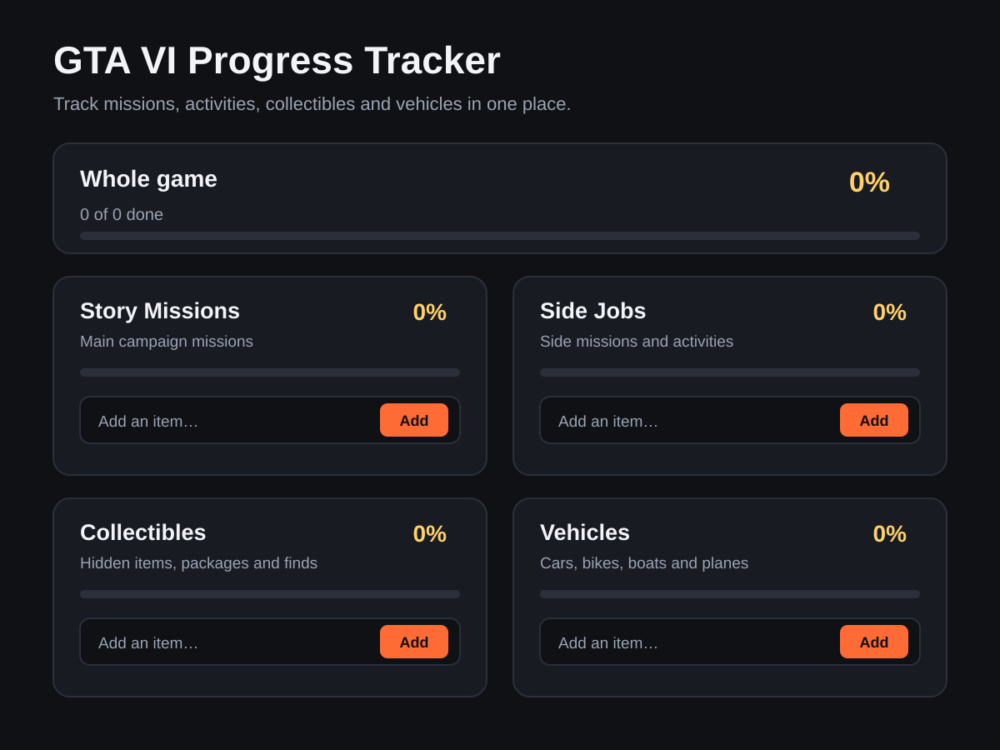

# GTA VI Progress Tracker

A lightweight, responsive checklist for tracking your GTA VI completion journey. Add your own missions and activities, mark completed items, leave notes, and monitor your overall progress.

## Features

- **Whole-game progress:** one completion percentage across every category.
- **Four tracking categories:** Story Missions, Side Jobs, Collectibles, and Vehicles.
- **Custom checklist items:** add the activities, finds, and vehicles you want to track.
- **Completion controls:** tick an item or use the Mark complete button.
- **Personal notes:** keep notes alongside each checklist item.
- **Automatic progress updates:** category and overall progress bars update as you work.
- **Automatic browser saving:** progress is stored locally with browser localStorage.
- **Responsive dark interface:** works on desktop and mobile.
- **No dependencies:** plain HTML, CSS, and JavaScript. No installation or account required.

## Run locally

1. Download or clone this repository.
2. Open `index.html` in a modern browser.
3. Add items to any category and start tracking.

## Publish with GitHub Pages

A GitHub Actions workflow is included at `.github/workflows/pages.yml`.

1. Open **Settings → Pages** in this repository.
2. Under **Build and deployment**, choose **GitHub Actions** as the source.
3. Push to the `main` branch. The workflow will build and deploy the static site.
4. Find the live URL under **Settings → Pages** or in the workflow deployment summary.

Expected URL: https://krish-nk.github.io/GTA-6-Progress-Tracker/

## Saving and privacy

Your checklist data is stored locally in the browser where you use the tracker. It is not uploaded to a server and does not automatically sync between browsers or devices. Clearing that browser's site data may erase saved progress.

## Tech stack

HTML · CSS · Vanilla JavaScript · Browser localStorage

## Disclaimer

This is an unofficial fan-made tracking tool. It is not affiliated with, endorsed by, or sponsored by Rockstar Games. Grand Theft Auto and GTA VI are trademarks of their respective owners.
